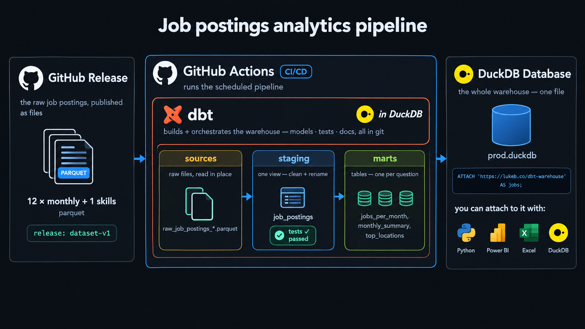
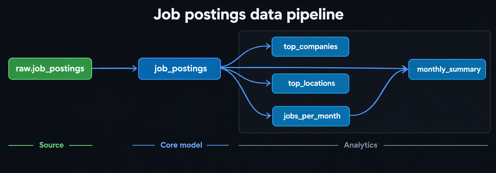

# Automated Job Postings Pipeline (v1) — dbt + DuckDB

[](https://github.com/chouaibmouidis-py/DBT_project/actions/workflows/dbt_build.yml)



A public dbt and DuckDB pipeline that transforms real job-posting data and automatically rebuilds and republishes the warehouse.

- Transforms raw postings into tested, documented analytical marts
- Publishes the finished warehouse as a public GitHub Release — no credentials required
- Runs automatically through GitHub Actions on every push to `master` and every Monday

> **Pipeline v1** is designed to be free and easy to run locally, using DuckDB as the warehouse and GitHub Actions for scheduling. [Version 2](../Project_2/) rebuilds the pipeline as a production-grade solution on Databricks.

| What I Built | How I Implemented It | Where to Look |
| --- | --- | --- |
| **dbt pipeline** | Declared sources → cleaned model → analytical marts | [`analytics/models/`](analytics/models/) |
| **Data tests** | `not_null` and `unique` tests on key columns | [`schema.yml`](analytics/models/schema.yml) |
| **dbt documentation** | Lineage, model and column descriptions, and tests | [Live docs site](#-docs) |
| **Public CI/CD** | Builds, tests, and publishes the warehouse through GitHub Actions | [Actions workflow](../.github/workflows/dbt_build.yml) |
| **Environments** | Separate local `dev` and CI `prod` targets | [`ci/profiles.yml`](ci/profiles.yml) |
| **Published warehouse** | Queryable by anyone with a single `ATTACH` command | [Query the published warehouse](#-query-the-published-warehouse) |

---

## ⚙️ The dbt Pipeline

Raw postings move through three dbt layers: declared sources, cleaned staging models, and analytical marts. Tests run as part of each build and must pass for the build to succeed. The DAG below shows the complete data flow:



The pipeline uses the following dbt features:

| dbt Feature | How I Used It |
| --- | --- |
| Model dependencies | Downstream models use `ref()` to reference `job_postings`; dbt determines the execution order and parallelism. |
| Materializations | The project defaults to `table` materializations, while `job_postings` is configured as a `view`. |
| Data tests | `not_null` and `unique` tests are defined in [`schema.yml`](analytics/models/schema.yml). |
| Environments | Separate local `dev` and CI `prod` targets are configured in [`ci/profiles.yml`](ci/profiles.yml). |

`dbt build` compiles the SQL, materializes the models, and fails if any test fails. The same command is used both locally and in CI.

---

## 🚀 Production

GitHub Actions runs the complete pipeline on a schedule, so no local machine is required: [`.github/workflows/dbt_build.yml`](../.github/workflows/dbt_build.yml).

| Trigger | What Happens |
| --- | --- |
| Push to `master` | Runs a full pipeline rebuild. |
| Weekly schedule (Monday) | Rebuilds the warehouse to keep it up to date. |
| Manual (`workflow_dispatch`) | Starts a run from the GitHub Actions interface. |

For each run, GitHub Actions:

1. Installs the dependencies with `uv` and dbt Fusion (v2.0.9).
2. Downloads the raw Parquet files.
3. Runs `dbt build` using the committed CI profile and the `prod` target.
4. Publishes `prod.duckdb` as a GitHub Release asset.

The status badge at the top of this README links to the latest workflow runs.

---

## 🦆 Query the Published Warehouse

No repository clone is required. [Install DuckDB](https://duckdb.org/docs/installation/) — version **1.5.x**, which was used to build the database file — then run the following in a DuckDB session:

```sql
INSTALL httpfs;
LOAD httpfs;

ATTACH 'https://github.com/chouaibmouidis-py/DBT_project/releases/download/warehouse/prod.duckdb' AS jobs (READ_ONLY);

USE jobs;
SHOW TABLES;

SELECT * FROM top_locations;
SELECT * FROM monthly_summary;
```

---

## 📖 Docs

The documentation is regenerated by the CI on every run and published at **[chouaibmouidis-py.github.io/DBT_project/](https://chouaibmouidis-py.github.io/DBT_project/)**.

You can also generate it locally with `dbt docs generate` (see [Run It Yourself](#-run-it-yourself)).

The documentation site includes:

- The complete **lineage graph**, from sources to models and marts
- **Model and column descriptions** defined in the YAML files
- The columns covered by **data tests**

---

## 💻 Run It Yourself

This project runs on **dbt v2 (Fusion 2.0.9)**. Install it once:

```bash
curl -fsSL https://public.cdn.getdbt.com/fs/install/install.sh | sh -s -- --update --version 2.0.9
dbt --version   # must print dbt 2.0.9
```

Then, from the `Project_1/` directory:

```bash
uv sync
uv run python scripts/download_data.py
cd analytics
dbt build --profiles-dir ../ci
```

The CI profile writes the database to `data/prod.duckdb`. Run dbt from `analytics/`, as the model paths are relative to that directory.

To generate and serve the documentation locally, run these commands from `analytics/`:

```bash
dbt docs generate --profiles-dir ../ci
dbt docs serve --profiles-dir ../ci
```

---

## 📁 Project Layout

```text
Project_1/
├── ci/profiles.yml             # Production DuckDB target used by GitHub Actions
├── data/                       # Raw data and warehouse files (gitignored; regenerated in CI)
├── img/                        # README diagrams
├── analytics/
│   ├── dbt_project.yml
│   └── models/                  # job_postings, marts, schema.yml, and sources.yml
└── scripts/download_data.py    # Downloads raw Parquet files before the build
```

The CI workflow is located at the repository root: [`.github/workflows/dbt_build.yml`](../.github/workflows/dbt_build.yml).

---

## 👨‍💻 Author
**Chouaib MOUID**
***Data Engineer***

📫 Contact & Liens
- LinkedIn : [MOUID / Chouaib](https://www.linkedin.com/in/chouaib-mouid-200893438/)
- GitHub : [Chouaib-mouid](https://github.com/chouaibmouidis-py)