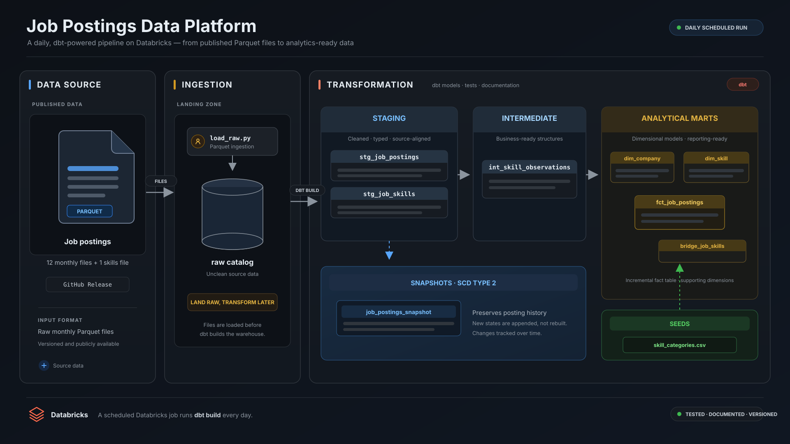
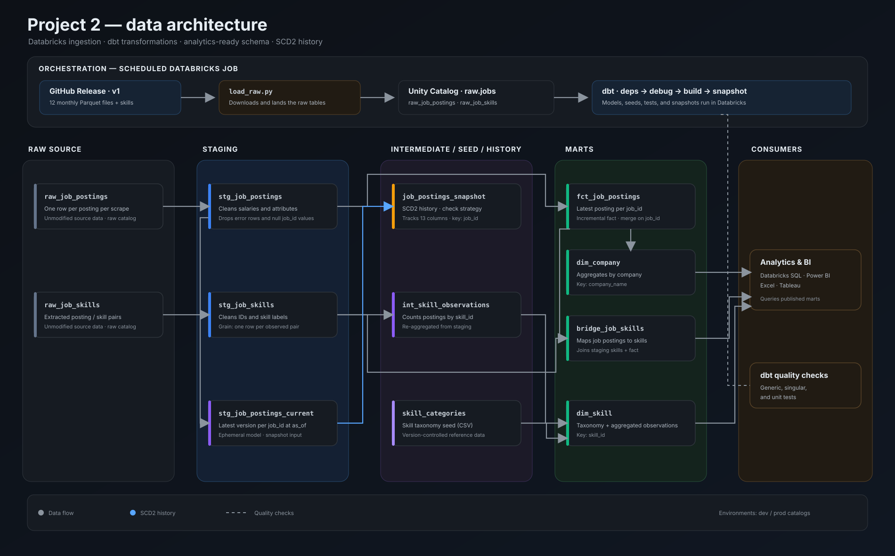

# Production Job Postings Pipeline (v2)

[](https://chouaibmouidis-py.github.io/DBT_project/project2/)




A production-oriented **dbt and Databricks** pipeline that transforms **843,097 raw job-posting scrapes** into tested, analytics-ready data. A scheduled Databricks Job rebuilds the pipeline nightly, with no credentials stored in the repository.

- **491,140 jobs** shaped into a tested star schema at a declared grain
- **504,591 historical versions** tracked with SCD2 snapshots
- Incremental fact loading and nightly orchestration on Databricks

> **Project evolution:** [v1](../project_1/) established the foundations with DuckDB and GitHub Actions. This v2 moves the same dataset to Databricks and adds a medallion architecture, incremental models, SCD2 history, and scheduled production runs.

## ✨ Project at a glance

| Capability | Implementation | Location |
| --- | --- | --- |
| **Star schema** | Fact, dimensions, and bridge at a declared grain | [`analytics/models/marts/`](analytics/models/marts/) |
| **SCD2 snapshots** | Backfilled salary and posting history | [`analytics/snapshots/`](analytics/snapshots/) and [`scripts/`](scripts/) |
| **Incremental fact** | Merge on `job_id`; load only new `search_date` values | [`fct_job_postings.sql`](analytics/models/marts/fct_job_postings.sql) |
| **Macros** | Custom salary parser and overridden schema-generation macro | [`analytics/macros/`](analytics/macros/) |
| **Data quality** | Generic, singular, custom generic, and unit tests | [`analytics/tests/`](analytics/tests/) and model property YAML files |
| **Environments** | `dev` and `prod` Unity Catalog catalogs | Databricks profiles and scheduled job |
| **Orchestration** | Nightly Databricks Job with no repository secrets | Databricks → Jobs & Pipelines |
| **Analyses** | SQL analyses alongside the models they explore | [`analytics/analyses/`](analytics/analyses/) |

## ⚙️ Data architecture

The pipeline follows the complete medallion-to-marts flow:

1. **GitHub Release:** monthly job-posting Parquet files and the skills file provide the source dataset.
2. **Raw ingestion:** [`scripts/load_raw.py`](scripts/load_raw.py) downloads the files into a Unity Catalog Volume and lands them as `raw.jobs.raw_job_postings` and `raw.jobs.raw_job_skills`. This ingestion task owns the raw tables; dbt reads them without rewriting them.
3. **Staging:** `stg_job_postings` and `stg_job_skills` clean and shape the raw data. The current-postings model provides the as-of view used by the snapshot.
4. **Intermediate:** `int_skill_observations` aggregates observed skills for downstream models.
5. **Seeds and marts:** the version-controlled `skill_categories` seed supplies the skill taxonomy. dbt builds the incremental `fct_job_postings`, `dim_company`, `dim_skill`, and `bridge_job_skills` models.
6. **History and analytics:** `job_postings_snapshot` records changes over time; SQL analyses and BI tools consume the published marts.



The diagrams show both the platform-level pipeline and the dbt model lineage. The lineage covers raw sources, staging, intermediate models, seeds, marts, and the snapshot.

### dbt features in use

| Feature | How it is used |
| --- | --- |
| **Declared sources** | `source('jobs', 'raw_job_postings')` keeps raw table references out of hardcoded model paths. |
| **Jinja** | A loop generates benefit flags; adding a keyword does not require repeating the SQL expression. |
| **Custom macro** | `parse_salary()` defines a salary-parsing expression once and reuses it four times. |
| **Package** | `dbt_utils.get_column_values()` lets the roles loop read values from the data instead of relying on a manually typed list. |
| **Macro override** | `generate_schema_name` places models in schemas based on their folders. |
| **Seeds** | The skill taxonomy is maintained as version-controlled reference data. |
| **Test-driven cleaning** | A `not_null` test surfaced 6,255 postings without IDs; those rows were excluded and the decision documented. |
| **Singular and custom tests** | `assert_salaries_sane` caught 27 typed `…–1M` salary ceilings that schema tests alone would not detect. |
| **SCD2 snapshots** | The `check` strategy tracks 13 content columns, with `searched_at` dating each version. |
| **Incremental models** | The fact model merges on `job_id` and uses `is_incremental()` with a `search_date` high-water mark. |
| **Environments** | Local builds use the `dev` catalog; only the scheduled job writes to `prod`. |

`dbt build` compiles SQL, materializes models, and runs tests. The same command is used locally and in the scheduled job.

## 🚀 Production and orchestration

Databricks provides the storage, compute, and scheduling runtime for the pipeline:

- **Separate environments:** local development writes to the `dev` catalog; the scheduled job writes the same schemas to `prod`.
- **Nightly workflow:** the Databricks Job runs `load_raw`, followed by `dbt deps` → `dbt debug` → `dbt build`. It pulls the project directly from GitHub.
- **Credential handling:** the job generates a temporary-credentials profile for the attached warehouse and revokes it after the run. No tokens or CI secrets are stored in the repository.
- **Analytics access:** SQL editors, Excel, Power BI, Tableau, and other BI tools can query the `prod` catalog directly.

## 📸 Snapshot insights

The marts expose the latest scrape for each job. The SCD2 snapshot retains every tracked version across 13 content columns:

- **504,591** version rows across **491,140** jobs
- **10,187** jobs with real change history
- **2,756** postings whose salary changed between scrapes

Related SQL analysis:

- [`in_demand_skills.sql`](analytics/analyses/in_demand_skills.sql) — explores the skills most in demand.

Snapshot analysis has also highlighted that Meta edited the most postings (415) and surfaced a posting whose salary changed from $60K to $1,000,000. The history helps reveal mid-edit data issues and salary typos.

## 📖 Documentation

The [Project 2 dbt documentation site](https://chouaibmouidis-py.github.io/DBT_project/) presents:

- The full lineage graph: raw → staging → intermediate → marts → snapshot
- Model and column descriptions defined in the project YAML files
- The tests associated with model columns

The same descriptions are persisted to Unity Catalog through `persist_docs`, making them available in Catalog Explorer alongside the data.

## 💻 Run the project

### Prerequisites

- A Databricks workspace; the [Databricks Free Edition](https://www.databricks.com/learn/free-edition) is sufficient.
- The raw job-postings tables loaded into the `raw` catalog. The ingestion script creates and populates `raw.jobs`.
- A local Databricks profile configured in `~/.dbt/profiles.yml`. Use your own workspace and credentials; do not commit credentials.
- [uv](https://docs.astral.sh/uv/) installed for Python environment and dependency management.

### Install and run

From the `Project_2` directory:

```bash
uv sync
source .venv/bin/activate
cd analytics
dbt deps       # Install dbt packages, including dbt_utils
dbt debug      # Check the Databricks connection and profile
dbt build      # Build models, run tests, and load seeds
dbt snapshot   # Run one SCD2 snapshot pass
```

`dbt_packages/` is generated by `dbt deps` and is not committed to the repository. In production, the scheduled Databricks Job runs the ingestion and dbt workflow nightly.

### Backfill snapshot history

To backfill one year of snapshot history in a single query, run [`scripts/backfill_job_postings_snapshot.sql`](scripts/backfill_job_postings_snapshot.sql) in the Databricks SQL Editor. After the backfill, `dbt snapshot` continues maintaining the history.

## 📁 Project structure

```text
Project_2/
├── analytics/
│   ├── dbt_project.yml
│   ├── models/
│   │   ├── sources.yml              # Declared raw.jobs sources
│   │   ├── staging/                 # Raw-data cleaning and current-posting view
│   │   ├── intermediate/             # Re-grained skill observations
│   │   └── marts/                   # Fact, dimensions, and bridge
│   ├── snapshots/                   # SCD2 job_postings_snapshot
│   ├── seeds/                       # Version-controlled skill taxonomy
│   ├── macros/                      # parse_salary, slugify, schema naming, tests
│   ├── tests/                       # Singular and custom generic tests
│   └── analyses/                    # SQL questions and analyses
├── scripts/
│   ├── load_raw.py                  # Databricks raw-ingestion task
│   └── backfill_job_postings_snapshot.sql
├── img/
│   ├── p2_pipeline.svg              # Platform-level architecture
│   └── schema_projet_2.svg          # dbt model lineage
├── pyproject.toml                   # Python project configuration
└── uv.lock                          # Locked Python dependencies
```

---

## 👨‍💻 Author
**Chouaib MOUID**
***Data Engineer***

📫 Contact & Liens
- LinkedIn : [MOUID / Chouaib](https://www.linkedin.com/in/chouaib-mouid-200893438/)
- GitHub : [Chouaib-mouid](https://github.com/chouaibmouidis-py)
